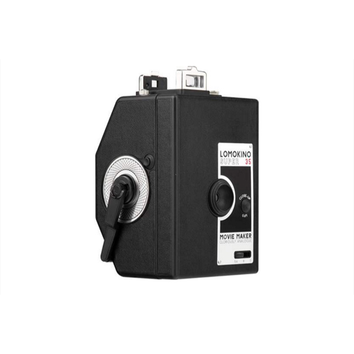
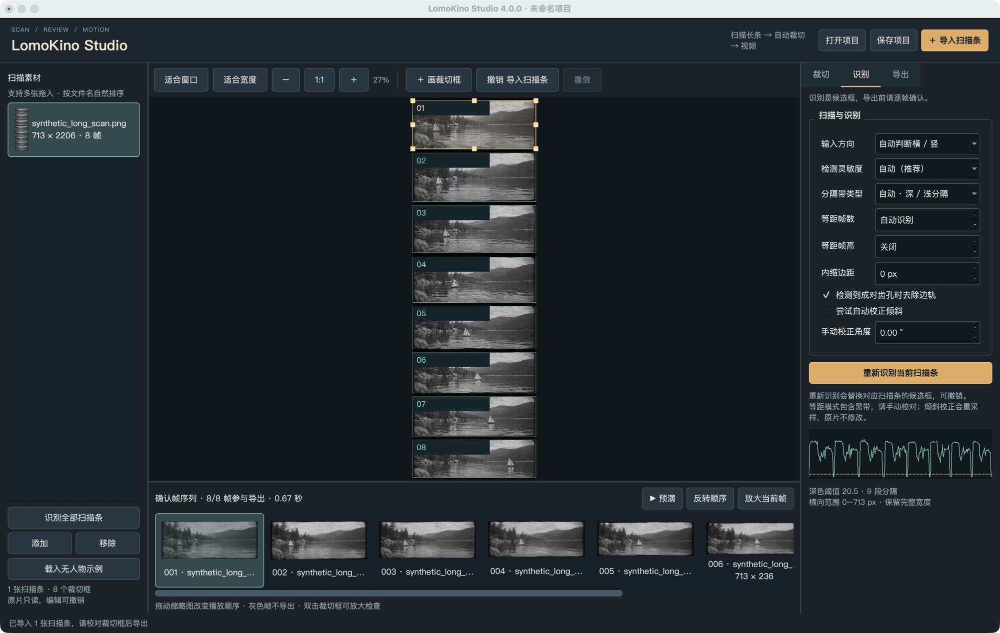
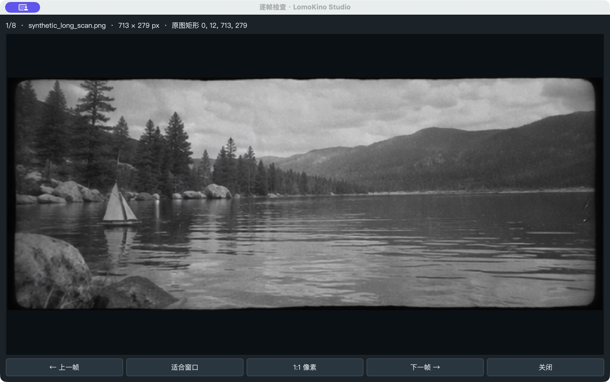
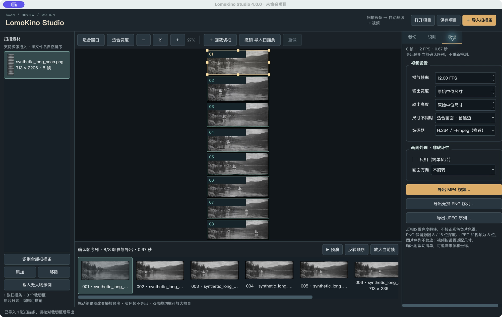

<div align="center">
  
  <h1>LomoKino Studio</h1>
  <p><strong>Scan a LomoKino strip. Automatically cut its frames. Export a movie.</strong></p>
  <p><a href="README.md">简体中文</a> · English · <a href="#interface">Interface</a> · <a href="#getting-started">Get started</a> · <a href="#precision-and-limitations">Precision</a> · <a href="#building">Build</a></p>
  <p><a href="https://github.com/JackerKun/lomokino_processor/releases">Releases</a> · <a href="https://github.com/JackerKun/lomokino_processor/issues">Issues</a> · <a href="LICENSE">License</a></p>
</div>

Scan your LomoKino film as long strips with your scanner first, then import the scans into LomoKino Studio. It automatically detects separator bands, cuts out individual frames, and converts the sequence into an MP4, saving the work of manually cropping every frame and assembling a movie. Optional pixel adjustments, exclusions, and ordering help with difficult scans. PNG / JPEG sequences can also be exported. The app processes existing scan files; it does not control a scanner. No account, cloud upload, or AI model is required. The interface is currently Simplified Chinese.

**Version 4 exports the edited sequence directly. It never redetects the original scans during export and silently discards your edits.**



## Interface

| Area | Purpose |
| --- | --- |
| Left source list | Import multiple scans, natural filename sorting, switch/remove sources, batch detection |
| Original-image canvas | Fit window/width, 1:1, pan/zoom, eight resize handles, manual rectangles |
| Crop inspector | Exact X/Y/width/height, live preview, include/exclude, duplicate/delete, review status |
| Detection inspector | Orientation, sensitivity, dark/light separators, paired perforations, uniform grids, deskew |
| Bottom sequence | Drag to reorder globally, reverse order, timer-based preview, enlarged frame inspection |
| Export inspector | FPS, output dimensions, letterbox/fill, H.264 or MPEG-4, simple inversion, right-angle rotation |






These are real macOS app captures. Image content comes from the AI-generated monochrome mountain lake and unmanned toy sailboat in `assets/demo/`; no people from the real test photos are shown. The synthetic content is not a real scanner sample or evidence of photographic detection accuracy.

## Getting started

Check [Releases](https://github.com/JackerKun/lomokino_processor/releases) for available desktop builds. A source update does not imply that a 4.0 release has already been published. On macOS unzip the application for your architecture. On Windows extract the **entire folder**, including `_internal`, before opening `LomoKinoGUI.exe`. macOS builds are ad-hoc signed and not notarized.

For source use Python 3.11/3.12 where possible; syntax requires Python 3.10+. Dependency availability varies by OS and architecture. Locally verified on macOS ARM64 with Python 3.13, Qt 6.10, and OpenCV 4.13.

```bash
git clone https://github.com/JackerKun/lomokino_processor.git
cd lomokino_processor
python3 -m venv venv
source venv/bin/activate
python -m pip install -r requirements_gui.txt
python lomokino_gui.py --demo
```

Windows PowerShell:

```powershell
py -3.11 -m venv venv
.\venv\Scripts\python.exe -m pip install -r requirements_gui.txt
.\venv\Scripts\python.exe lomokino_gui.py --demo
```

1. Import JPEG, PNG, TIFF, or BMP scans. Horizontal strips default to a counterclockwise 90° rotation into the vertical working canvas.
2. Check candidate rectangles. Orange suggests unusual frame heights or weak evidence; green remains a candidate rather than a guarantee.
3. Drag a frame or any of its eight handles; use integer coordinates for fine adjustment. Double-click to inspect an enlarged frame.
4. Exclude leader/blank frames, reorder thumbnails, and mark checked frames reviewed. Changes support undo/redo.
5. Preview the sequence. The Qt timer preview is for reviewing order and rhythm, not a frame-accurate professional playback engine.
6. Export lossless PNG frames or set FPS and export H.264 MP4. Save a `.lomokino.json` project to continue later.

`--demo` and the person-free demo button load one bundled synthetic monochrome strip (8 frames) from `assets/demo/`. No personal photos or people are required. The public scan is AI-generated in the style of an edge-cropped film scan, with no perforations. `scripts/generate_public_demo.py` separately writes deterministic fixtures to `output/synthetic-fixtures`. The retained real scan `demo/8.jpg` is separate regression data and is not shown in public screenshots. Original files are not modified.

## Precision and limitations

Rectangles use **working-image pixel coordinates after orientation normalization and optional deskew**: `[x, x + width)` and `[y, y + height)`. Preview scaling and display DPI do not change stored coordinates. Unrotated crops are integer array slices; arbitrary-angle deskew expands and resamples the working image. Source files remain read-only.

The detector measures strip-specific dark/light separator evidence, looks for periodic perforations on both sides before removing rails, and uses content width to avoid dropping frames on long strips. It does **not** trim a fixed percentage from every scan. Weak evidence produces review warnings instead of assuming eight frames. Optional equal-count/equal-height grids are explicitly approximate and may include separator bands. Auto deskew is opt-in; manual adjustment is limited to ±6°.

The retained original scan `demo/8.jpg` has 9 manually reviewed frames and 9 detected frames. The public AI-generated person-free strip has 8 frames and 8 detections. These are separate data types, not a combined accuracy rate. See the [current audit](docs/validation/demo-report.json). The earlier nine-scan/44-frame result remains in the [historical report](docs/validation/demo-report-original-2026-11-06.json); removed source photos are not restored. Count agreement does not establish pixel-boundary accuracy, and synthetic samples are not evidence of real-scan success rates.

Dark scenes, shadows, uneven exposure, curved/perspective scans, and mixed formats can require manual correction. There is no perspective unwarping, stabilization, deflicker, frame interpolation, audio track, or color-negative mask correction. Inversion simply flips channel values. ICC/EXIF preservation, RAW, HDR, and multipage TIFF workflows are not implemented.

## Export and projects

- PNG preserves 8/16-bit integer source depth. JPEG uses 8-bit quality 95. Image sequences keep each crop's own dimensions.
- H.264 uses bundled FFmpeg/libx264 with CRF 18 and yuv420p. OpenCV `mp4v` is a separate MPEG-4 Part 2 fallback, not H.264.
- FPS: 1–60. Video dimensions default to each axis's median crop size, rounded up to even pixels; maximum edge 8192. Choose letterboxing or centered filling; frames are not stretched.
- Sequence exports include `frames.json` with source path, rectangle, working dimensions, orientation, deskew, inversion/rotation, and bit depth.
- Projects save source references, rectangles, include/review states, global order, and export settings. **Projects do not embed or back up photos.** Copy original sources when moving a project. Missing sources can be relinked; changed size/mtime triggers a review notice.
- Sequence exports require a new directory. Videos are staged and read back for frame-count verification before replacing the destination; cancellation preserves existing completed files.

Manifests and project references may include local paths. Check them before publishing.

## Shortcuts

| Action | Shortcut |
| --- | --- |
| New/open/save project | Ctrl / Cmd + N / O / S |
| Undo/redo | Ctrl / Cmd + Z / Shift + Z |
| Zoom | Ctrl / Cmd + wheel, toolbar − / + |
| Pan | Space + drag, middle-button drag |
| Move selected rectangle | Arrows: 1 px; Shift + arrows: 10 px, with canvas focused |
| Delete selected rectangle | Delete/Backspace, with canvas focused |
| Inspect previous/next | Left/right in the frame dialog |

Ordinary wheel scrolling moves through the scan. Sidebars can be hidden in the View menu; splitters are adjustable. Minimum window size: 1040 × 680.

## CLI

```bash
python lomokino_processor.py "demo/*.jpg" -o output/my-film --fps 12
python lomokino_processor.py assets/demo/synthetic_long_scan.png -o output/example --frames-only --format png
python lomokino_processor.py --project film.lomokino.json -o output/final --fps 18
python lomokino_processor.py --help
```

Each invocation combines its inputs into one naturally sorted sequence. `--project` respects GUI edits, exclusions, and ordering. Choose a new output directory if `frames/` already exists. Direct scan processing exports unreviewed candidates; inspect important results in the GUI first.

## Development and validation

```bash
QT_QPA_PLATFORM=offscreen python -m unittest discover -s tests -v
python scripts/validate_demo.py --output output/demo-audit
python scripts/validate_demo.py --output output/demo-export --export
```

In PowerShell set `$env:QT_QPA_PLATFORM="offscreen"` first. The 26 regression tests cover pixel geometry, all resize directions, zoom/preview mapping, numeric edits and undo, real scan counts, negative/16-bit variants, lossless sequences, project relinking, exclusions/order, CLI FPS, video encoding, and cancellation protection.

The `lomokino/` package separates models, detection, engine, canvas, UI, and packaged smoke checks. Root GUI/CLI files remain entry points. Older documents in `docs/` are historical; use this README and [4.0 changes](docs/CHANGELOG-4.0.md) for current behavior.

## Building

Run `./build_app.sh` on macOS or `build_app.bat` on Windows. Both use the same PyInstaller spec, run tests, and include FFmpeg. Only the person-free synthetic strips are bundled; real photo test data and AI models are not bundled.

GitHub Actions defines native macOS ARM64, macOS Intel, and Windows x64 jobs. Tests, demo audits, and packaged codec checks run before archive upload. Manual dispatch produces Artifacts; pushing a `v*` tag produces Releases after all jobs succeed. Windows ARM64 and Linux packages are not configured. Only macOS ARM64 has been built and interactively checked locally in this iteration; other platform outputs require CI and native validation.

```bash
git tag v4.0.0
git push origin v4.0.0
# Headless bundle check, with a new destination folder:
dist/LomoKinoGUI.app/Contents/MacOS/LomoKinoGUI --self-test /tmp/lomokino-package-check
```

A smoke-check exit code of 0 and `result.json` indicate successful H.264/PNG output; failures write `error.txt`. On Windows use `dist\LomoKinoGUI\LomoKinoGUI.exe --self-test package-check`. This is not a replacement for UI testing.

## License and feedback

Project code: [MIT](LICENSE). Third-party components retain their own licenses, including PyQt6 and the bundled FFmpeg/libx264 builds; see [third-party notes](docs/THIRD-PARTY.md). Report your OS, version, scan dimensions, settings, expected counts, and a shareable minimal example in [Issues](https://github.com/JackerKun/lomokino_processor/issues).
