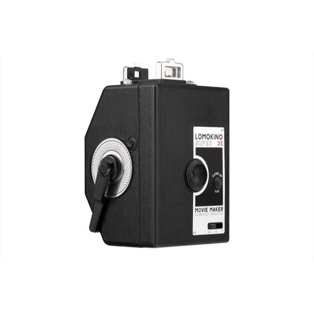
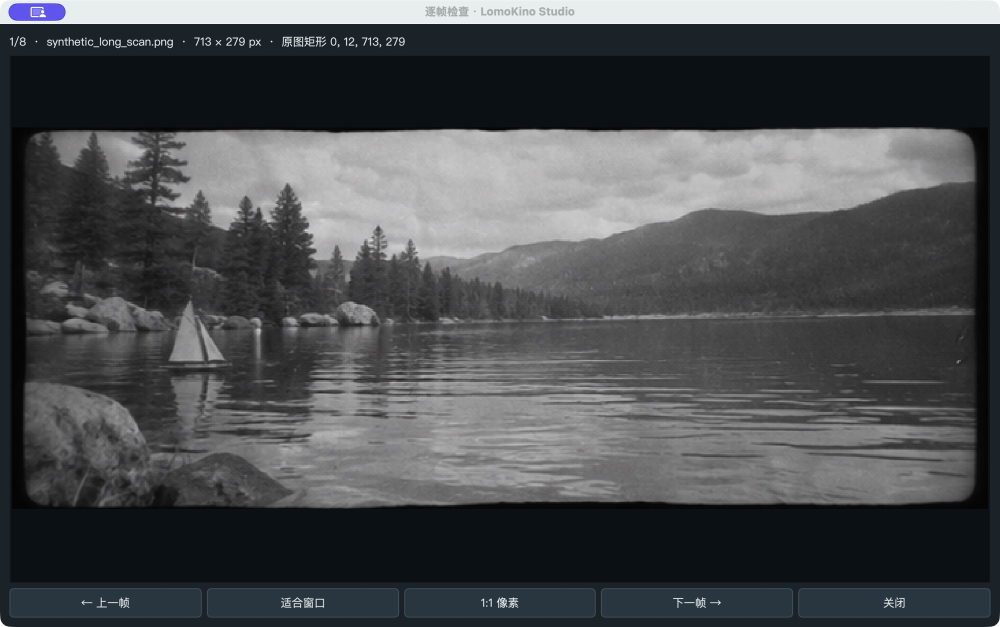
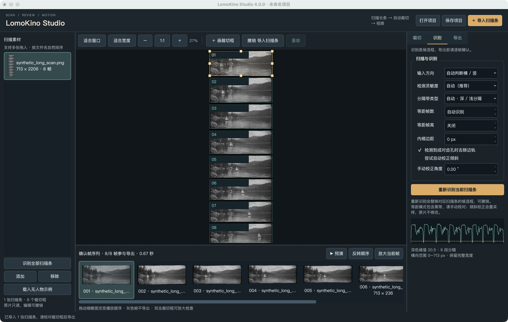
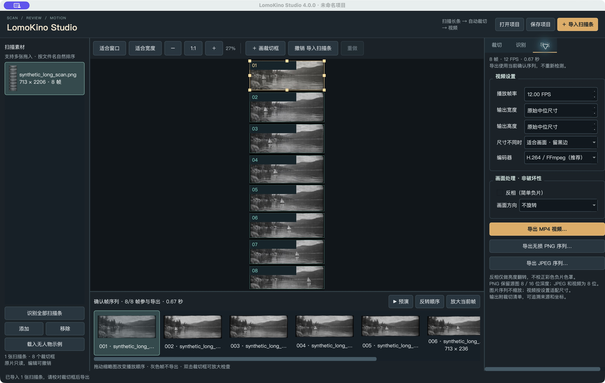

<div align="center">
  
  <h1>LomoKino Studio</h1>
  <p><strong>LomoKino 长条扫描，自动裁切转视频。</strong></p>
  <p>简体中文 · <a href="README.en.md">English</a> · <a href="#界面导览">界面导览</a> · <a href="#快速开始">快速开始</a> · <a href="#裁切精度与识别边界">裁切精度</a> · <a href="#构建与发布">构建发布</a></p>
  <p><a href="https://github.com/JackerKun/lomokino_processor/releases">下载版本</a> · <a href="https://github.com/JackerKun/lomokino_processor/issues">反馈问题</a> · <a href="LICENSE">MIT License</a></p>
</div>

拍完 LomoKino，先用扫描仪把胶片扫成长条，再把长条扫描图导入 LomoKino Studio。软件自动识别分隔带、裁切出连续画格，按顺序转换成 MP4 视频，省去逐格手动切图再拼视频的重复操作。也可以导出 PNG / JPEG 图片序列，或微调少量识别不准的边界。图片在本机处理，不需要账户、云端服务或 AI 模型。

**扫描仪扫成长条 → 软件自动分帧裁切 → 确认顺序和帧率 → 导出视频。** 本软件处理已经扫描好的图片，不直接控制扫描仪。

4.0 重做了裁切与导出流程：**导出使用你当前确认的裁切和序列，不会重新检测源图覆盖手工调整。**


## 界面导览

| 工作区 | 可以做什么 |
| --- | --- |
| 左侧扫描素材 | 多图导入、自然文件名排序、切换扫描条、移除素材、批量识别 |
| 中央原图校对 | 适合窗口 / 宽度、1:1、缩放平移、拖动裁切框、八个边角调整、手动画框 |
| 右侧裁切属性 | 输入 X / Y / 宽 / 高整数像素，预览当前帧，排除、复制、删除、标记已复查 |
| 右侧识别参数 | 横竖方向、深 / 浅分隔带、灵敏度、齿孔边轨、等距模式、内缩与倾斜校正 |
| 底部确认帧序列 | 拖动缩略图排序、反转顺序、定时预演、打开大图逐帧检查 |
| 右侧导出 | 1–60 FPS、视频尺寸、保留比例 / 裁满、H.264 / MPEG-4、反相与 90° 旋转 |

<details>
<summary>查看逐帧检查、识别与导出截图</summary>

**逐帧检查**：查看单帧实际内容、源图矩形与像素尺寸，左右切换检查。



**识别参数**：先自动识别，再针对特殊扫描调整。等距模式需要人工校对。



**导出设置**：图片序列保持裁切尺寸，视频单独适配画布。



</details>

公开示例参考 `demo/8.jpg` 的黑白长条扫描外观：连续横幅画格、帧间黑带、窄黑边和颗粒质感，不画扫描范围之外的齿孔。

截图来自本机实际构建的 macOS 应用，画面中使用 `assets/demo/` 内的AI 生成的黑白长条：山水与无人模型帆船，**不含测试照片中的人物**。界面是真实截图，图片内容是虚构示例，不是真实扫描仪样片，也不用于衡量实拍识别准确率。

## 快速开始

### 下载桌面应用

前往 [Releases](https://github.com/JackerKun/lomokino_processor/releases) 查看已有构建。4.0 的源码与工作流更新不会自动变成已发布安装包，需维护者推送版本标签后构建。

启动时会在后台检查更新，离线时仍可继续编辑和导出。排查启动问题时，可在 Windows 命令提示符进入程序目录，运行 `LomoKinoGUI.exe --no-update-check` 跳过本次自动检查。仍可在「帮助」菜单里手动检查。

- macOS：解压对应 Apple Silicon / Intel 的 ZIP，打开 `LomoKinoGUI.app`。构建仅临时签名，未完成 Apple 公证；首次打开按系统提供的“仍要打开”流程处理。
- Windows：解压整个 ZIP，保持 `LomoKinoGUI` 文件夹完整，再打开其中的 `LomoKinoGUI.exe`。不能只复制 EXE，`_internal` 里包含 Qt、OpenCV 与 FFmpeg。
- GUI 目前为简体中文；英文 README 便于了解使用方式，尚未提供英文界面。

### 从源码运行

建议 Python 3.11 或 3.12；代码使用 Python 3.10+ 语法。依赖能否安装还受目标系统与轮子支持范围影响。本机验证环境：macOS ARM64、Python 3.13、Qt 6.10、OpenCV 4.13。

```bash
git clone https://github.com/JackerKun/lomokino_processor.git
cd lomokino_processor
python3 -m venv venv
source venv/bin/activate
python -m pip install -r requirements_gui.txt
python lomokino_gui.py --demo
```

Windows PowerShell：

```powershell
py -3.11 -m venv venv
.\venv\Scripts\python.exe -m pip install -r requirements_gui.txt
.\venv\Scripts\python.exe lomokino_gui.py --demo
```

macOS 也可运行 `./install_gui.sh`、`./run_gui.sh --demo`；Windows 对应 `install_gui.bat`、`run_gui.bat --demo`。脚本会切换到项目目录，支持路径包含空格。

### 第一次做一段电影

先在扫描仪或其扫描软件中把胶片扫成长条，保留完整画格与分隔带，导出 JPEG / PNG / TIFF 等图片；不用事先逐格裁开。

1. 点击“导入扫描条”，选一张或多张 JPEG / PNG / TIFF / BMP，软件会自动分帧。拖入图片也可导入；横向长条默认逆时针旋转为竖向工作图。
2. 观察候选框。绿色表示普通候选，橙色提示帧高不规则或证据不足，选中的框显示金色边角。颜色是启发式提示，仍需自行检查内容。
3. 拖动框移动位置；拖八个边角调整大小。右侧输入像素坐标做精修，双击框或点击“放大当前帧”检查。
4. 取消“包含此帧”排除片头、残帧或空白；底部拖动缩略图调整顺序。检查后可标记“已逐帧复查”，也可整条标记。
5. 点击“预演”确认顺序与节奏。它是基于 Qt 定时器的顺序预演，不是精确计时的专业播放器。
6. 在“导出”设定 FPS 和尺寸。默认 12 FPS；先尝试 PNG 序列，再导出 H.264 MP4。
7. 保存 `.lomokino.json` 项目，保留扫描原图，下次打开继续编辑。

`--demo` 或“载入无人物示例”直接加载内置的 **1 张黑白合成长条 / 8 帧**，无需另找照片。示例由 AI 生成，不含真人和用户原片。另有 `scripts/generate_public_demo.py` 可生成具有已知像素边界的程序测试图，默认写入 output/synthetic-fixtures。它用于公开截图和上手体验，不能替代实拍检测测试。当前保留的 `demo/8.jpg` 实拍扫描图继续供回归验证使用，未用于本页截图。

## 裁切精度与识别边界

### 手工坐标与导出的一致性

裁切框使用**方向归一化、可选纠偏之后的工作图像像素坐标**。未纠偏时是整数像素切片；启用任意角度纠偏会生成扩展画布并重采样，原片文件保持不变。

矩形使用左闭右开边界：`[X, X + 宽)`、`[Y, Y + 高)`。例如 `X=10, Y=20, 宽=100, 高=50`，取第 10–109 列、第 20–69 行。预览缩放与高 DPI 不改变保存的坐标；导出直接使用同一个矩形，边界约束避免负索引、越界和反向矩形。

PNG 序列保留输入 8 / 16 位整数深度，不为了统一视频尺寸而缩放。JPEG 与视频转换为 8 位。源文件的 ICC / EXIF 不作为完整元数据迁移流程保留；目前没有色彩管理、RAW 解码、HDR 或多页 TIFF 工作流。

### 自动识别更保守

- 分别评估深色、浅色分隔带，支持已反转扫描与简单负片扫描条件。
- 依据条带自身亮度测量阈值；窄场景线与相邻碎片结合判断，减少把画面里的水平线误当分隔。
- 只有两侧反复、周期性齿孔的证据同时成立时才去边轨。**不会对所有图片固定裁掉左右 8%。**
- 最小帧高参考内容宽度，避免长扫描条因整图高度而漏掉正常帧。
- 没有足够分隔证据时保留待复查候选，不再强行默认切成 8 帧。
- 可显式指定等距帧数 / 帧高，也可手工加框。等距网格并不意味着识别到了真实黑带。
- 可选自动或手动 ±6° 校正；自动纠偏默认关闭，避免场景线导致不必要的重采样。

暗场、大面积阴影、曝光不足、弯曲或透视变形、拼接错位、不同规格混合扫描仍可能误判。当前不做透视展开、逐帧稳像、插帧、去闪烁、音轨或彩色负片色罩还原。简单反相只是翻转通道数值。

### 测试数据结果

当前可复查数据分开记录：

| 输入 | 类型 | 人工查看帧数 | 默认识别帧数 |
| --- | --- | ---: | ---: |
| `demo/8.jpg` | 保留的真实长条扫描，仅用于回归 | 9 | 9 |
| `assets/demo/synthetic_long_scan.png` | 无人物 AI 合成示例，用于公开截图 | 8 | 8 |

[当前审核报告](docs/validation/demo-report.json) 记录实际存在的文件。最初九张扫描图共 44 帧的审核结果保存在[历史报告](docs/validation/demo-report-original-2026-11-06.json)，已移除的原片不会被脚本恢复。

帧数吻合不代表边界逐像素准确，也不是通用识别成功率；AI 合成长条不能用来推断实拍准确率。合成图测试另行验证已知像素边界、负片与 16 位变体的坐标。

## 导出与文件安全

| 输出 | 行为 |
| --- | --- |
| PNG 序列 | 无损编码，保留 8 / 16 位深度；逐帧尺寸可不同 |
| JPEG 序列 | 8 位、有损编码，质量 95 |
| H.264 MP4 | 默认 FFmpeg / libx264、CRF 18、yuv420p、无音轨，便于常见播放器播放 |
| MPEG-4 MP4 | OpenCV `mp4v` 备用编码，**不是 H.264** |
| `frames.json` | 图片序列附裁切矩形、源路径、工作图尺寸、方向、纠偏角、旋转、反相和位深记录 |
| `.lomokino.json` | 工程保存源图引用、裁切、顺序、包含 / 排除、复查状态与导出参数；不嵌入图片 |

视频尺寸为 0 时，各轴取已启用帧对应尺寸的中位数，并补到偶数；最大边 8192。保留比例模式加黑边，裁满模式居中裁掉超出的内容，不拉伸画面。图片序列不使用这些视频尺寸设置。

原扫描文件只读。序列导出要求新文件夹，临时写完再提交；视频先写临时 MP4，检查帧数可读后替换目标，取消不会覆盖已有成片。关闭未保存工程会提示保存。工程不是原片备份：移动到其他电脑时请一起复制源图；缺失时可逐个重新定位，大小或修改时间变化会提示复查。

裁切清单含本机源路径。分享清单或工程前，可先检查其中的文件名和路径是否适合公开。

## 快捷键

| 操作 | 按键 |
| --- | --- |
| 打开 / 保存 / 新建工程 | Ctrl / ⌘ + O / S / N |
| 撤销 / 重做 | Ctrl / ⌘ + Z / Shift + Z |
| 缩放 | Ctrl / ⌘ + 滚轮，或工具栏 − / ＋ |
| 平移 | 空格 + 拖动，或鼠标中键拖动 |
| 移动选中框 | 方向键 1 px，Shift + 方向键 10 px（原图画布获得焦点时） |
| 删除选中框 | Delete / Backspace（原图画布获得焦点时） |
| 逐帧检查弹窗切换 | 左 / 右方向键 |

普通滚轮滚动扫描条，不会意外连续缩放。侧栏可在“视图”菜单隐藏，小屏幕可拖动三栏分隔条分配空间；最低窗口为 1040 × 680。

## 命令行

```bash
# 合并多张扫描条；文件名自然排序，输出序列、工程和视频
python lomokino_processor.py "demo/*.jpg" -o output/my-film --fps 12

# 仅输出无损帧；有必要时显式设置等距数量并自行检查
python lomokino_processor.py assets/demo/synthetic_long_scan.png -o output/example --frames-only --format png

# 使用 GUI 保存的手工裁切、排除和播放顺序
python lomokino_processor.py --project my-film.lomokino.json -o output/final --fps 18

# 特殊扫描：浅色分隔带、顺时针转竖向、手动纠偏
python lomokino_processor.py scan.tif -o output/check --polarity light --orientation horizontal-cw --angle 1.2
```

`python lomokino_processor.py --help` 查看完整参数。导出目录中的 `frames/` 必须不存在；重复执行请使用新目录。CLI 按指定输入直接输出，自动候选未经人工复查，正式使用建议先通过 GUI 检查。

## 开发与验证

```bash
QT_QPA_PLATFORM=offscreen python -m unittest discover -s tests -v
python scripts/validate_demo.py --output output/demo-audit
python scripts/validate_demo.py --output output/demo-export --export
```

Windows 在 PowerShell 先设置 `$env:QT_QPA_PLATFORM="offscreen"`，再运行相同测试命令。26 项回归覆盖坐标边界、八个拖拽方向、缩放与长图预览映射、手工改框撤销重做、实拍帧数、正负片、16 位序列、工程重定位、包含状态与顺序、CLI 帧率、视频编码与取消保护。

```text
lomokino/
  models.py       # 唯一像素矩形与工程模型
  detection.py    # 分隔带、齿孔与可选纠偏
  engine.py       # 文件、工程、图片与视频导出
  canvas.py       # 原图像素坐标交互
  ui.py           # Qt 工作区和后台任务
  smoke.py        # 打包依赖与编码自检
assets/           # 应用图标、无人物合成长条
scripts/          # demo 审核工具
tests/            # 回归测试
docs/             # 新版截图、验证报告与历史说明
demo/             # 保留的实拍回归扫描图
lomokino_gui.py    # GUI 入口
lomokino_processor.py # CLI 与旧处理类适配器
```

旧 `docs/` 中的早期版本说明保留供追溯；当前行为以本 README、[快速上手](QUICKSTART.md)、[4.0 变更](docs/CHANGELOG-4.0.md) 和测试为准。早期“固定百分比裁切”“100% 准确”等表述不适用于当前版本。

## 构建与发布

本机打包 `./build_app.sh` 或 Windows `build_app.bat`。构建脚本安装依赖、先测试，再通过同一个 PyInstaller spec 打包；仅打包无人物合成示例，不包含原有实拍 demo。FFmpeg 随依赖一起收集，运行时无需另装 Python 或下载模型。

GitHub Actions 配置 macOS ARM64、macOS Intel、Windows x64 三个原生构建任务。工作流测试、审查 demo、打包后编码自检，通过后上传 ZIP；`workflow_dispatch` 手动构建只上传 Artifacts，推送 `v*` 标签才创建 Releases。macOS 使用 [GitHub 提供的原生架构 runner](https://github.com/actions/runner-images)。Windows ARM64 和 Linux 安装包尚未配置。

```bash
git tag v4.0.0
git push origin v4.0.0
```

上述命令是维护者发布步骤，不代表此版本已在线发布。Windows 与 Intel 包仍需在对应机器验证交互与安装；本次本地构建验证为 macOS ARM64。

打包后可无界面检查 H.264、PNG 与依赖，使用一个新的输出目录：

```bash
dist/LomoKinoGUI.app/Contents/MacOS/LomoKinoGUI --self-test /tmp/lomokino-package-check
# Windows：dist\LomoKinoGUI\LomoKinoGUI.exe --self-test package-check
```

返回码 0 且生成 `result.json` 表示自检通过；失败时查看 `error.txt`。这不替代完整的人工 UI 验证。

## 许可与反馈

项目代码采用 [MIT](LICENSE)。Qt、OpenCV、NumPy、imageio-ffmpeg 与 FFmpeg 各自遵循其许可；所带 FFmpeg / libx264 构建可能涉及 GPL，应用分发须保留其声明并遵循相应源码提供义务，MIT 不替代这些要求。详见 [第三方组件说明](docs/THIRD-PARTY.md)。

提交问题时，附系统、版本、扫描图尺寸、识别设置、期望帧数和实际结果。有条件时提供可公开的最小样本。不要附个人原片目录、私密照片或未脱敏工程。
